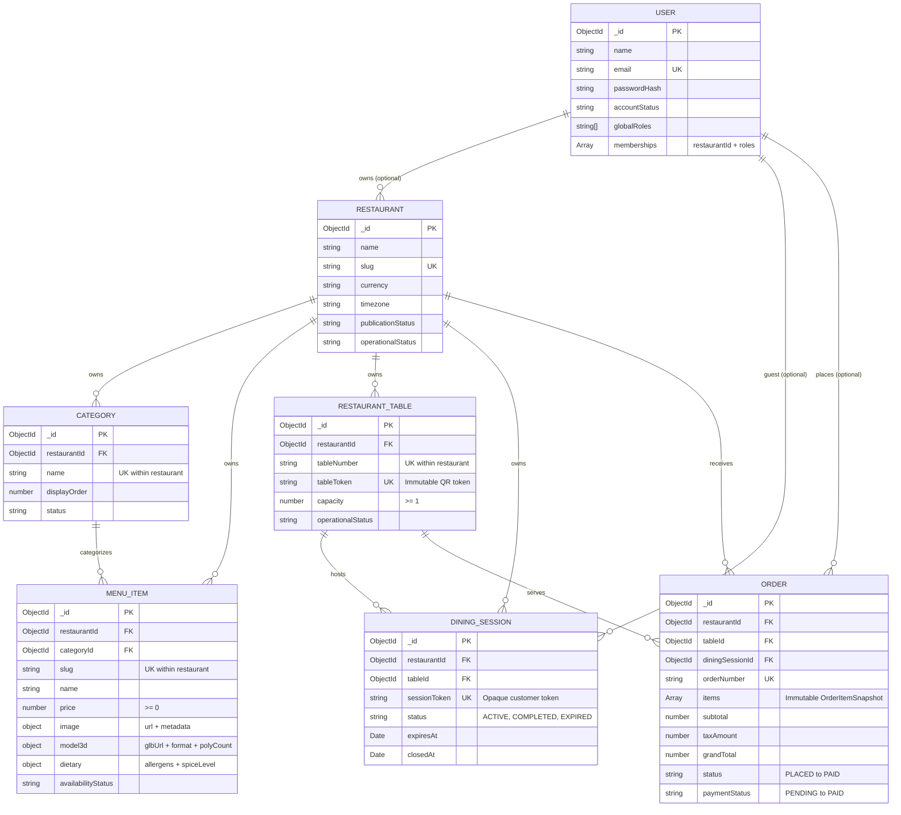

# AR-DINE — Database Architecture & Multi-Tenant Data Design

> **Course:** College Project-I (CEUP301), Semester V  
> **Component:** MongoDB Atlas & Mongoose Schemas Specification (Phase 2)

---

## 1. Data Model Overview

AR-DINE utilizes a multi-tenant document model implemented with MongoDB Atlas and Mongoose. Data isolation is enforced at the collection level via canonical `restaurantId` references, compound indexes, and service-layer boundary verification.

> **Important Architectural Note:** MongoDB document references (`ref: '...'`) represent **logical relationships** managed by the application layer. Unlike relational databases (RDBMS), MongoDB does not automatically enforce foreign key constraints across collections. Cross-collection integrity (such as ensuring a category or table belongs to the same restaurant as an order) is enforced by the application's `TenantValidationService` and compound indexes.



---

## 2. Collections & Schemas

### 2.1 Restaurant (`restaurants`)
The root tenant entity representing a distinct dining establishment.
- **`slug`:** Globally unique, lowercase identifier (e.g. `spice-craft-kitchen`) used in public restaurant URLs.
- **`contact` & `address`:** Structured subdocuments for operational details.
- **`currency` / `timezone`:** Standard ISO codes (`INR`, `Asia/Kolkata`) for regional financial calculation and operational cutoffs.
- **Compound Index:** `{ publicationStatus: 1, operationalStatus: 1 }` for active catalog queries.

### 2.2 User (`users`)
Multi-tenant user and staff identity model.
- **`email`:** Unique, normalized lowercase string.
- **`passwordHash`:** Excluded from default projections (`select: false`), reserved for Argon2/Bcrypt in Phase 3.
- **`memberships`:** Multi-restaurant membership array:
  ```json
  [
    {
      "restaurantId": "651a...",
      "roles": ["RESTAURANT_ADMIN"]
    }
  ]
  ```
  Enables a single user (e.g. restaurant owner or consultant) to access multiple establishments with distinct roles.

### 2.3 Category (`categories`)
Menu classification within a restaurant.
- **Compound Unique Index:** `{ restaurantId: 1, name: 1 }` ensures category names cannot be duplicated within the same establishment while allowing different restaurants to use identical category names (e.g., "Starters").

### 2.4 MenuItem (`menu_items`)
Dish catalog with 3D/AR asset pipeline references.
- **Media Storage Philosophy:** Binary model files (`.glb`, `.gltf`, `.usdz`) and high-resolution images are **never stored directly in MongoDB**. MongoDB stores only secure external CDN URLs, format metadata, polygon count, and file size.
- **Compound Unique Index:** `{ restaurantId: 1, slug: 1 }`.
- **Query Index:** `{ restaurantId: 1, categoryId: 1, publicationStatus: 1, availabilityStatus: 1 }`.

### 2.5 RestaurantTable (`restaurant_tables`)
Physical dining table representation.
- **`tableToken`:** A cryptographically random, non-sequential token (e.g., `tbl_spice_01`) embedded in tabletop QR codes.
- **Stable QR Architecture:** Because physical QR stickers point to `https://ardine.app/table/{tableToken}`, table menus, prices, and dish names can be updated repeatedly on the backend without reprinting QR stickers.
- **Compound Unique Index:** `{ restaurantId: 1, tableNumber: 1 }`.

### 2.6 DiningSession (`dining_sessions`)
Ephemeral dining lifecycle for guests at a table.
- **`sessionToken`:** Opaque token stored in guest browser session storage.
- **Lifecycle:** Created when guest scans table QR; remains active during dining; expires automatically (`expiresAt`) or closes upon bill settlement (`closedAt`).
- **Compound Index:** `{ restaurantId: 1, tableId: 1, status: 1 }`.

### 2.7 Order (`orders`)
Order lifecycle and financial snapshot.
- **Immutable Item Snapshots (`OrderItemSnapshot`):** Each order item freezes `name`, `unitPrice`, `quantity`, `subtotal`, and `specialInstructions` at the exact millisecond of ordering. Subsequent edits to dish prices or names in `menu_items` never alter historical orders.
- **Status State Machine:**
  $$\text{PLACED} \longrightarrow \text{CONFIRMED} \longrightarrow \text{PREPARING} \longrightarrow \text{READY} \longrightarrow \text{SERVED} \longrightarrow \text{PAID}$$
- **Orthogonal Payment Status:** `paymentStatus` (`PENDING`, `PAID`, `REFUNDED`, `FAILED`) is decoupled from kitchen preparation. A dish can be `PREPARING` while payment is `PENDING` (post-dining billing) or `PAID` (pre-paid digital checkout).

---

## 3. Multi-Tenant Isolation Strategy

AR-DINE implements zero-trust tenant boundary enforcement:

1. **Explicit Query Scoping:**
   All read and write queries utilize `TenantHelper.scopeQuery(restaurantId, filter)` to guarantee `restaurantId` is present in the query filter.
2. **Cross-Entity Integrity Validation:**
   `TenantValidationService` verifies that foreign keys passed during item or order creation (e.g. `categoryId`, `tableId`) belong to the verified tenant before saving.
3. **No Unauthenticated Client Trust:**
   Client-supplied query parameters or body fields specifying `restaurantId` are never trusted as proof of authorization. The tenant context will be derived from validated JWT tokens in Phase 3.

---

## 4. Development Seed Fixtures

A deterministic, idempotent seed script is provided for local and staging development:

```powershell
# Set your development MongoDB Atlas connection string in backend/.env:
# MONGODB_URI=mongodb+srv://...

cd D:\AR_Dine\backend
npm run seed
```

### Safety Controls:
- **Production Guard:** Throws an immediate error and exits if `NODE_ENV=production`.
- **Idempotency:** Uses MongoDB `findOneAndUpdate` with `{ upsert: true }` keyed on unique identifiers (`slug`, `email`, `tableToken`). Re-running the script does not generate duplicate records.
