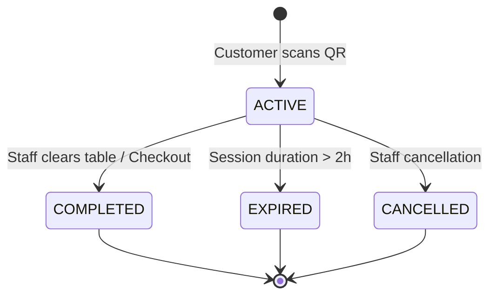

# AR-DINE — Dining Session Lifecycle & Security

## 1. Overview
Dining sessions track the active seating lifecycle of customers at physical restaurant tables. They correlate browser menu interactions and cart states with real-time table occupancy.

## 2. Session Lifecycle States
A session transitions through four distinct states defined by `SessionStatus`:
1. `ACTIVE`: Created when customers first scan the physical table QR code. The table status automatically transitions from `AVAILABLE` to `OCCUPIED`.
2. `COMPLETED`: Set by restaurant staff or automated checkout when the dining party pays and departs. Table status transitions back to `AVAILABLE`.
3. `EXPIRED`: Triggered when session duration exceeds the 2-hour default validity window (`expiresAt <= Date.now()`).
4. `CANCELLED`: Admin/Staff override if a reservation or table seating is revoked.



## 3. Session Security
- **Opaque Session Identifier:** Tokens follow the format `ses_<24-byte-hex>` (e.g. `ses_4a6f8b...`) with 192 bits of cryptographic entropy.
- **Application-Level Expiry:** MongoDB TTL indexes are supplemented by strict application-level date checks:
  ```typescript
  if (session.expiresAt <= new Date()) {
    session.status = SessionStatus.EXPIRED;
    await session.save();
    throw new UnauthorizedException('Dining session has expired');
  }
  ```
- **Tenant & Table Boundary Enforcement:** A session token is permanently locked to its `{ restaurantId, tableId }`. A diner cannot use a token from Restaurant A to view or order from Restaurant B.

## 4. Multi-Customer Physical Table Sharing
When multiple diners sit at the same physical table:
1. Diner A scans Table 4 QR: An `ACTIVE` session is initialized.
2. Diner B and Diner C scan Table 4 QR: The server detects an active, unexpired session for Table 4 and returns the existing session token.
3. All diners at Table 4 share the active session context.
4. When the party departs and staff clears the table, the session is marked `COMPLETED`, allowing the next dining group to begin a fresh session.
